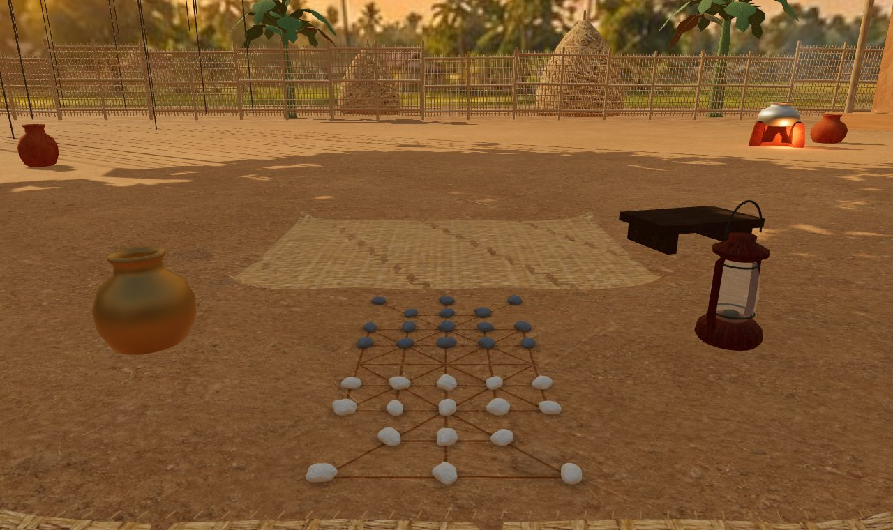
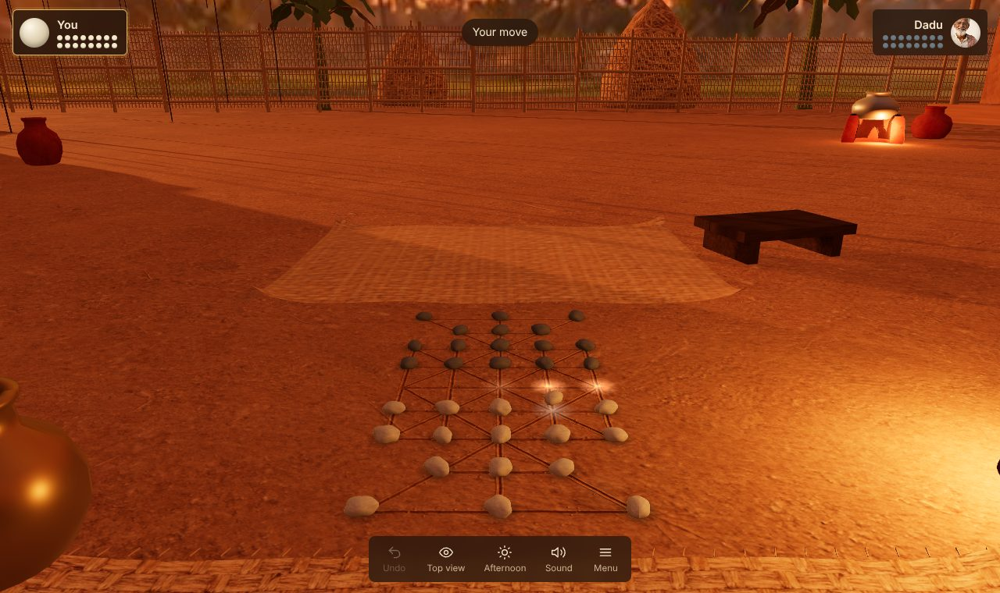
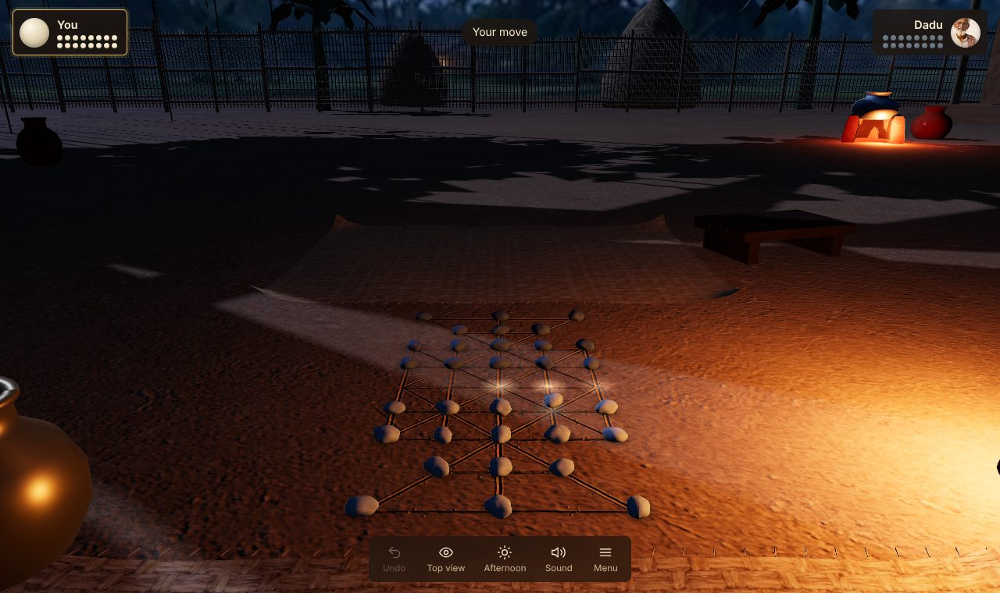
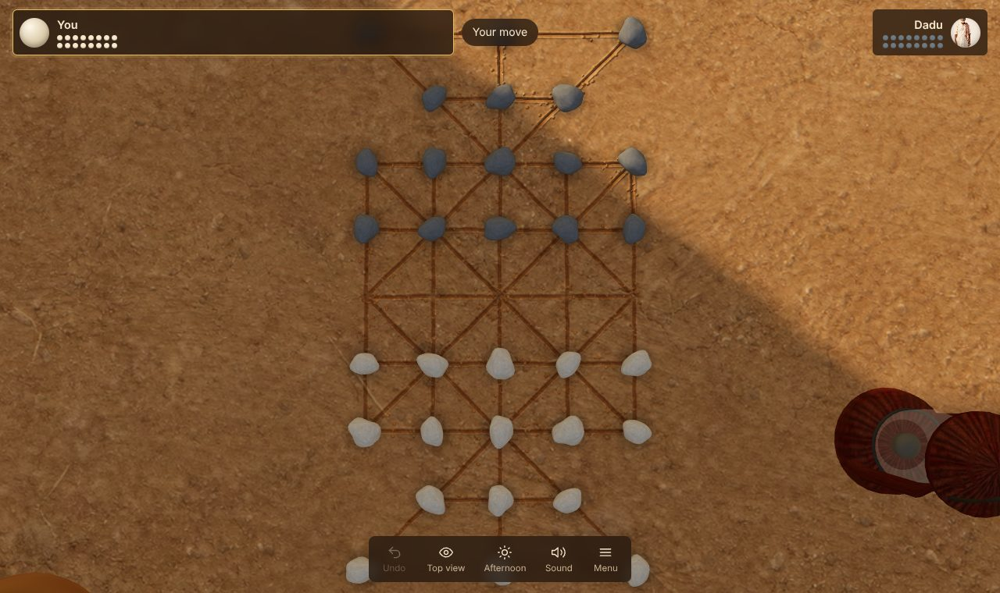

# ষোল গুটি · Sholo Guti

A 3D version of Sholo Guti, the traditional Bangladeshi 16-piece board game, played in realistic, living environments.
Two environments are playable in the browser: **Village Uthan** (a mud courtyard under a banyan tree) and
**Old Dhaka Rooftop** (a Puran Dhaka roof during Shakrain, the kite festival). Pick the place in the menu.



| Sunset | Night | Top view |
|---|---|---|
|  |  |  |

## Play it

**Windows:** double-click `game/start-game.bat`.
**macOS / Linux:** run `game/start-game.sh`.

Both start a local web server with Python on port 8080 and open http://localhost:8080.
Opening `index.html` directly from disk does not work, because browsers block loading the 3D files from `file://`.
Everything, including three.js and the fonts, is bundled, so the game runs offline.

**Android:** the same game is packaged as an Android app with Capacitor. See [docs/ANDROID.md](docs/ANDROID.md) for building, installing on a phone and publishing on Google Play.

Any static web host works too (GitHub Pages: serve the `game/` folder).

## What works now

- Full rules on the real 37-point board: steps, jump captures, chain captures, win by capture or blockade, draw after 60 quiet moves.
- Play the computer at Easy, Medium or Hard (**Dadu** in the village, **Rana**, champion of the next roof, on the rooftop), or two players on one device (the view turns to face each player).
- Settings: place, captures optional or forced, River pebbles, Clay & tamarind or Marbles & bottle caps guti, time of day (afternoon / sunset / night in the village, dusk / night on the roof), graphics quality.
- The board is carved into the mud by a shader, drawn from the same data the rules use, so the picture can never disagree with the moves.
- Living courtyard: chickens wander and scatter on captures, leaves fall, chula smoke, dust in sunbeams, fireflies and a flickering lantern at night, birds by day, crickets at night.
- Festive rooftop: the board is chalked on the cement between jute mats; hundreds of kites over the city (now and then one is cut loose and drifts away), neighbours flying kites from the roofs around, string lights and paper lanterns, lit windows, a fire-breather on the next roof, fireworks, rising sky lanterns, a crowd murmur. Captures throw sparks; long chains set off fireworks.
- Move hints (gold), jump arcs (orange), undo, top/seat camera, orbit and zoom, phone and desktop layouts.

## Repository layout

```
game/                    the playable game (static files, no build step)
  index.html             page for local use, generated from page.html
  page.html              the page body (edit this, then run build_index.py)
  js/rules.js            rules engine: board graph, moves, jumps, chains, win/draw. No graphics
  js/ai.js               Dadu: negamax + alpha-beta, iterative deepening, capture quiescence
  js/ai-worker.js        runs the AI off the main thread
  js/world.js            Village Uthan: sky, carved-board ground shader, props layout, lights, time of day, particles, chickens;
                         plus the helpers every environment shares (sky, time-of-day blending, prop placement, instancing)
  js/rooftop.js          Old Dhaka Rooftop: chalk board, roof and neighbouring houses, kites, string lights, fireworks, fire-breather
  js/pieces.js           guti meshes, hop/capture animations, move hints, capture piles
  js/audio.js            synthesised sounds (no audio files)
  js/main.js             renderer, loading, camera, input, turn flow, UI
  assets/models/*.json   models as base64-wrapped GLB (served by any host, incl. Claude artifacts)
  assets/models-glb/     the same optimized models as plain .glb, for Unity / Godot / Blender
  assets/tex/            seamless textures + normal maps, panoramas, effect sprite sheets, kite atlas
  assets/ui/             loading art, Dadu and Rana portraits, app icons
  vendor/                three.js r169 and the fonts, bundled for offline play
  manifest.webmanifest   installable web app; sw.js caches it for offline use
art/                     original source art (Village Uthan, Old Dhaka Rooftop), full resolution
  art_bible.txt          art direction: palette, materials, lighting, rules (rooftop_art_bible.txt for the roof)
  concepts/              concept art + the exact prompts used
  textures/ panoramas/ models/ ui/ previews/ production/
tools/                   asset pipeline, tests, screenshot tool
  prepare_assets.py      art/ -> game/assets/ (resize + WebP models, seamless textures, normal maps)
  make_icons.py          app icon for the web app and Android, Android splash screens
  build_web.py           game/ -> www/ (runtime files only) for the Android app
  test_rules.mjs         rules checks + AI self-play
  screenshot.py          headless screenshots of the running game
docs/
  BUILD_GUIDE.md         step-by-step guide to continue with Claude Code
  GAME_PLAN.md           design plan, environments, roadmap, status
  ASSET_PROMPTS.md       ChatGPT prompts for the art, and templates for the next environments
  ANDROID.md             build, install and publish the Android app
  screenshots/
android/                 Capacitor Android project (open in Android Studio)
package.json             Capacitor packages and the android:* npm scripts
CLAUDE.md                technical notes for continuing development (also read by Claude Code)
```

## Set up on another PC

1. Install [Git](https://git-scm.com/), [Python 3](https://www.python.org/) and, for the asset pipeline only, [Node.js](https://nodejs.org/) 18+.
2. Clone and run:
   ```
   git clone https://github.com/sumnoon/16-Guti.git
   cd 16-Guti/game
   start-game.bat          (Windows)   or   ./start-game.sh   (macOS/Linux)
   ```
3. To edit, open the folder in VS Code. Change files in `game/js/` or `game/page.html`, then refresh the browser.
   After editing `page.html`, run `python build_index.py` in `game/`.

### Rebuild assets after changing art

If you changed raw source images or the procedural models, rebuild `art/` first (details in `art/README.md`):

```
cd art
python production/process_images.py
python production/build_models.py
python production/inspect_assets.py
python production/package_assets.py
```

Then convert `art/` into the game's files:

```
cd tools
npm install
pip install -r requirements.txt
python prepare_assets.py            (or: prepare_assets.py village / prepare_assets.py rooftop)
```

### Run tests

```
cd tools
node test_rules.mjs 2      (2 = number of AI self-play games)
```

## Next steps

**Start with [docs/BUILD_GUIDE.md](docs/BUILD_GUIDE.md)**: setup, the daily loop with Claude Code, and ready-to-paste prompts for every milestone.
See [docs/GAME_PLAN.md](docs/GAME_PLAN.md) for the full plan. The most useful next pieces of work:

1. **Better models** for the banyan, house and chickens. These are low-poly first passes, and the banyan's hanging roots cast long stripe shadows across the courtyard. Replace files in `art/models/` (keep names, metres, bottom-centre origin) and run `prepare_assets.py`.
2. **Tutorial**: Dadu teaches the rules step by step in the courtyard (`window.__game.loadPosition` already sets up any position).
3. **Next environment**: Monsoon Ghat. Generate art with the prompts in `docs/ASSET_PROMPTS.md`, then add a module like `rooftop.js` and register it in `ENVS` in `main.js`.
4. **Bangla interface** and voice lines.
5. **Port to Unity (URP)** for an Android release. `rules.js` and `ai.js` are small and port directly to C#. The models in `assets/models-glb/` import as they are.

## Credits

Art direction and source art: generated with ChatGPT image tools from the prompts in `art/` and `docs/ASSET_PROMPTS.md`.
Procedural models: `art/production/build_models.py`.
Engine: [three.js](https://threejs.org/) r169. Fonts: Tiro Bangla, Hind Siliguri (Google Fonts).
